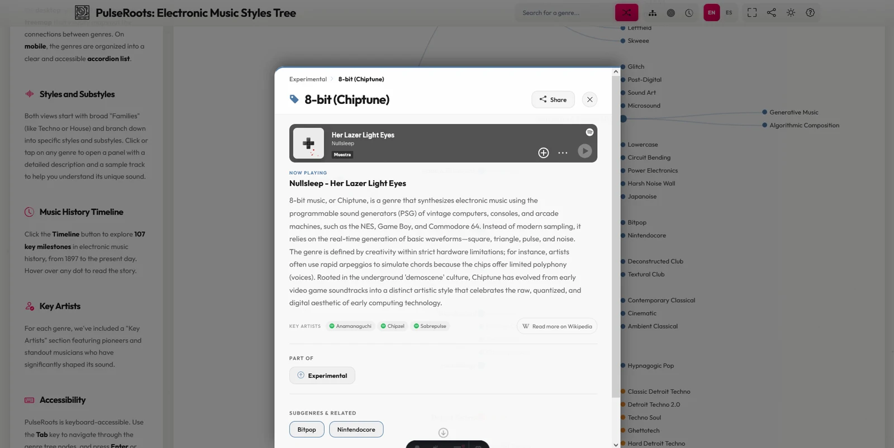
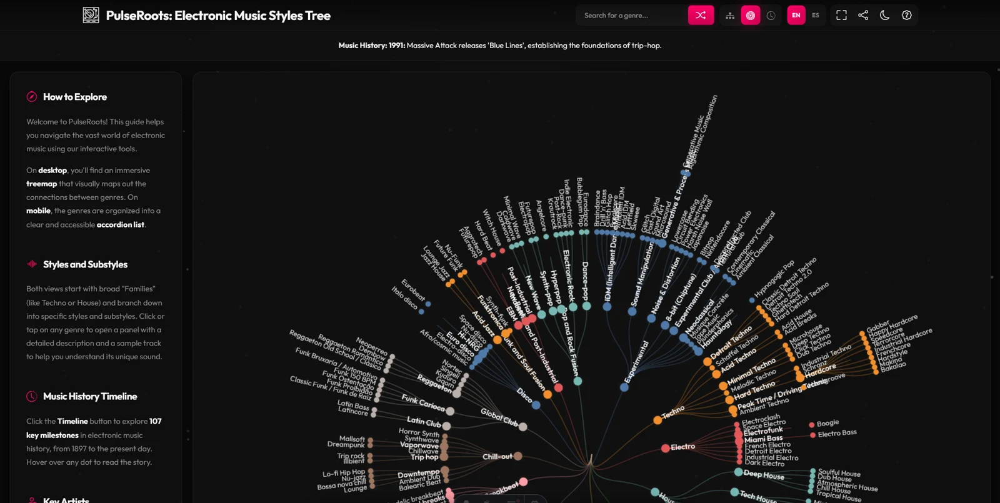

# PulseRoots: Electronic Music Styles Tree

PulseRoots is an interactive visualization of the evolution of electronic music. It presents the complex web of genres and subgenres as a hierarchical tree, allowing users to explore the history, characteristics, and sounds of electronic music through an intuitive interface.

**Live Demo:** [https://mendiak.github.io/pulse.roots/](https://mendiak.github.io/pulse.roots/)

## Screenshots

| Light mode | Dark mode |
|:---:|:---:|
|  |  |

## Features

- **Interactive Visualization**: Choose between Tree, Radial, and **Timeline** layouts powered by D3.js.
- **Deep Historical Context**: Detailed descriptions and Wikipedia links for hundreds of genres.
- **Curated Listening**: Sample tracks via integrated Spotify embeds for every style.
- **Music History Timeline**: Explore 107 key milestones in electronic music history (1897–2024) — 47 events include external links to Wikipedia, official sites, and festival pages.
- **Search & Discover**: Find specific genres or use the "Shuffle" feature for random discovery.
- **Responsive Design**: Fully optimized for both desktop (interactive map) and mobile (accordion navigation).
- **SEO Optimized**: Automatic sitemap generation, per-genre pages, JSON-LD structured data.
- **Multi-language**: English and Spanish with Astro i18n.

## Technologies Used

- **Framework**: [Astro](https://astro.build/) (static site generation)
- **Frontend**: HTML5, CSS3, JavaScript (ES6+), D3.js (v6), Bootstrap Icons.
- **Data & Tools**: Spotify Embed API (public iframes), Web3Forms (contact form).
- **Deployment**: GitHub Pages via GitHub Actions.

## Setup & Local Development

1. **Clone the repository**:
   ```bash
   git clone https://github.com/Mendiak/pulse.roots.git
   cd pulse.roots
   ```

2. **Install dependencies**:
   ```bash
   npm install
   ```

3. **Run development server**:
   ```bash
   npm run dev
   ```

4. **Build for production**:
   ```bash
   npm run build
   ```

5. **Preview production build**:
   ```bash
   npm run preview
   ```

The built site is output to `dist/` and is ready for deployment.

## Data Structure

The project's heart is `public/data/pulseroots.genres.json`. It follows a recursive tree structure:

```json
{
  "style": "Genre Name",
  "description": "Historical and sonic description...",
  "example": "Artist - Track Name",
  "spotify_track_id": "Spotify_ID",
  "wikipedia_url": "https://en.wikipedia.org/...",
  "key_artists": [
    { "name": "Artist Name", "url": "Spotify_Artist_URL" }
  ],
  "substyles": [
    /* Recursive substyle objects */
  ]
}
```

Translations are stored in `public/data/i18n/` (en.json, es.json) with ~188 keys each, loaded at runtime by the client-side i18n module.

The project also includes `public/data/music_history.json`, a linear array of historical milestones used by the interactive timeline:

```json
{
  "date": "1994",
  "fact": "The first Sónar festival takes place in Barcelona...",
  "url": "https://sonar.es"
}
```

- **`date`** (string): Year of the event.
- **`fact`** (string): Description of the milestone.
- **`url`** (string, optional): External link to Wikipedia, official site, or related content.

## Project Structure

```
pulse.roots/
├── src/
│   ├── js/                  # Client-side ES6 modules (main.js, tree.js, panel.js, search.js, etc.)
│   ├── utils/               # Build-time Node.js scripts (genres-data.js, genreTree.js)
│   ├── components/          # Astro UI components (Header.astro, Footer.astro)
│   ├── islands/             # Astro interactive islands (CookieConsent.astro)
│   ├── layouts/             # BaseLayout.astro
│   ├── pages/               # Routes (index, contact, privacy, thanks, sitemap, genres/[...slug])
│   │   └── es/              # Spanish page overrides
│   └── styles/              # Modular CSS (variables, base, header, panel, footer, responsive, etc.)
├── public/
│   ├── data/
│   │   ├── i18n/            # Translation JSON files (en.json, es.json)
│   │   ├── pulseroots.genres.json  # The database of genres
│   │   ├── pulseroots.genres.es.json
│   │   ├── music_history.json      # Historical music facts
│   │   └── music_history.es.json
│   ├── assets/              # Images, icons, branding
│   ├── robots.txt
│   └── .nojekyll
├── docs/
│   └── screenshots/         # README screenshots (light and dark mode)
├── dist/                    # Production build output (generated)
├── scripts/                 # Legacy translation utilities
├── .env                     # Local environment variables (gitignored)
├── .env.example             # Environment variable template
├── astro.config.mjs         # Astro configuration
├── tsconfig.json
└── package.json
```

## Contributing

Contributions are welcome! Whether it's correcting a genre description, adding new substyles, or improving the visualization logic:
1. Fork the repo.
2. Create your feature branch.
3. Submit a Pull Request.

## License

This project is open source and available under the [MIT License](LICENSE).

---
*PulseRoots - Explore the roots, discover the sound.*
